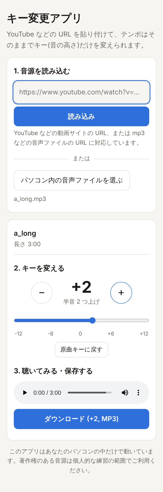

# キー変更アプリ

YouTube などの動画サイトの URL(または音声ファイル)から音声を取り出し、
**テンポ(速さ)はそのままで、キー(音の高さ)だけを半音単位で上げ下げ**できるアプリです。
変えた音はブラウザでその場で聴けて、MP3 で保存できます。



- 対応: YouTube などの動画・音声サイト(yt-dlp が対応しているサイト)、mp3 などの音声ファイルの URL、パソコン内の音声ファイル
- キーの範囲: −12 〜 +12(半音単位。12 で 1 オクターブ)
- 長さ 20 分まで、ファイルサイズ 200MB まで
- このアプリは **あなたのパソコンの中だけ** で動きます(他の人からはアクセスできません)

---

## 準備(最初の 1 回だけ)

必要なものは 3 つです。

| 必要なもの | 用途 |
|---|---|
| Python(3.10 以上) | アプリ本体を動かす |
| ffmpeg | 音声の変換 |
| deno | YouTube の読み込みに必要(他のサイトだけなら無くても動きます) |

### Windows の場合

1. **スタートボタンを右クリック →「ターミナル」**(または「Windows PowerShell」)を開きます。
2. 次の 3 行を 1 行ずつ貼り付けて Enter を押します。

   ```
   winget install --id Python.Python.3.12 -e
   winget install --id Gyan.FFmpeg -e
   winget install --id DenoLand.Deno -e
   ```

   途中で「同意しますか?」と聞かれたら `Y` を押して Enter。
3. **ターミナルを一度閉じます**(インストールしたものを認識させるため)。

> `winget` が使えない場合は、Python は https://www.python.org/downloads/ からインストールしてください。
> インストール画面の最初で **「Add python.exe to PATH」に必ずチェック** を入れてください。

### Mac の場合

1. 「アプリケーション」→「ユーティリティ」→ **「ターミナル」** を開きます。
2. Homebrew が入っていなければ、https://brew.sh/ja/ の「インストール」欄にある 1 行をターミナルに貼り付けて Enter(パスワードを聞かれたら Mac のログインパスワードを入力。入力中は何も表示されませんが正常です)。終わったら画面の「Next steps」の指示に従ってください。
3. 次の 1 行を貼り付けて Enter。

   ```
   brew install python ffmpeg-full deno
   ```

   > `ffmpeg-full` は高音質なキー変更機能(rubberband)入りの ffmpeg です。
   > 普通の `ffmpeg` でも動きますが、その場合は音質が少し落ちる「簡易モード」になります。
   > `ffmpeg-full` は他のアプリと場所が別になることがありますが、このアプリは自動で見つけます。

---

## 起動のしかた

このフォルダ(`key-changer`)をデスクトップなど分かりやすい場所に置いてください。

### Windows

**`start.bat` をダブルクリック** します。

- 黒い画面が開き、初回は部品のインストールで数分かかります。
- 準備ができると自動でブラウザに `http://127.0.0.1:8000` が開きます(8000 番がほかのアプリで使用中なら、空いている番号で開きます)。
- 「Windows によって PC が保護されました」と出たら「詳細情報」→「実行」を押してください。

### Mac

**`start.command` をダブルクリック** します。

- 「開発元を検証できないため開けません」と出た場合は、`start.command` を **右クリック(control + クリック)→「開く」→「開く」** で起動できます。
- 「アクセス権がありません」と出た場合は、ターミナルで次を実行してから再度ダブルクリックしてください
  (`cd ` のあとにスペースを入れ、`key-changer` フォルダをターミナルにドラッグ&ドロップすると場所が入力されます)。

  ```
  cd (key-changer フォルダの場所)
  chmod +x start.command start.sh update.command
  ```

### Linux

```
./start.sh
```

### 使い方

1. YouTube などの URL を貼り付けて **「読み込み」**(またはパソコン内の音声ファイルを選ぶ)。
2. スライダーか **− / +** ボタンでキーを変えます。聴きながら変えると、再生は止まらずに、その場ですぐ音の高さが切り替わります(再生する前に変えておくこともできます)。
   - 保存する MP3 は、聴いている音とは別に高音質で作ります。そのため、聴いている音と少し違って聞こえることがあります。
   - 古いブラウザなど、その場で切り替える機能が使えないときは、これまでどおり「変換中…」のあとに切り替わります(聴いているキーの近く(2 つ隣まで)は先回りして変換してあるので、すぐに切り替わります)。
3. 再生ボタンで確認し、**「ダウンロード」** で MP3 を保存します。ファイル名は「曲名 (+2).mp3」のようになります。MP3 は保存するときに作るので、長い曲では「MP3 を作成中…」と数秒表示されることがあります。

### 終了のしかた

黒い画面(ターミナル)で **Ctrl + C** を押すか、そのウィンドウを閉じます。
ブラウザのタブを閉じただけではアプリは止まりません。

---

## うまくいかないとき

### YouTube が読み込めなくなった(急に「ダウンロードに失敗しました」と出る)

YouTube は仕様がよく変わるため、読み込みに使っている部品 **yt-dlp を最新版に更新** すると直ることが多いです。

- Windows: **`update.bat` をダブルクリック**
- Mac: **`update.command` をダブルクリック**
- Linux: `./update.sh`

更新後、アプリを起動し直してください。

### 「JavaScript 実行環境 (deno) が見つからない」と出る

最近の YouTube の読み込みには **deno** が必要です。「準備」の手順で deno をインストールし、
黒い画面を閉じてからアプリを起動し直してください。

- Windows: `winget install --id DenoLand.Deno -e`
- Mac: `brew install deno`

### 「ffmpeg が見つかりません」と出る

「準備」の手順で ffmpeg をインストールし、**黒い画面を閉じてから** 起動し直してください。
(Windows はパソコンの再起動が必要なこともあります。)

### 「Python が見つかりません」と出る

「準備」の手順で Python をインストールしてください。Windows で python.org からインストールした場合は
「Add python.exe to PATH」にチェックを入れ直して再インストールしてください。

### 音質について

ffmpeg に「rubberband」という高音質な変換機能が入っていればそれを使います。
無い場合は簡易方式で変換し、画面に「簡易モード」と表示されます(使えますが、音質が少し落ちることがあります)。

「簡易モード」と表示されて高音質にしたい場合:

- Windows: `winget install --id Gyan.FFmpeg -e`(full 版。essentials 版には入っていないことがあります)
- Mac: `brew install ffmpeg-full`(Homebrew の普通の `ffmpeg` には入っていません)

インストール後、黒い画面を閉じてアプリを起動し直してください。

### 起動しない・セットアップが毎回失敗する

初回セットアップを途中で止めた場合などに起こることがあります。
**`key-changer` フォルダの中の `.venv` フォルダを削除してから**、もう一度起動してください
(`.venv` は隠しフォルダです。Mac では Finder で `command + shift + .` を押すと表示されます)。
Linux(Ubuntu など)で「仮想環境を作れませんでした」と出る場合は `sudo apt install python3-venv` を実行してください。

### その他

- ポート 8000 がほかのアプリで使われているときは、空いている番号(8001 など)を自動で選んで起動します。開くアドレスは黒い画面に表示されます。番号を決めておきたいときは環境変数 `KEYCHANGER_PORT` で指定できます(指定した番号が使用中の場合は、ほかの番号には移らず、その旨を表示して終了します)。
- キーを変えたあと、保存に備えてそのキーを裏で変換します(その場で切り替えられないブラウザでは、次に聴きそうな近くのキー(2 つ隣まで)も先回りして変換します)。そのため、少しの間パソコンのファンが回ることがあります。気になる場合は環境変数 `KEYCHANGER_PREFETCH=1`(隣だけ)や `KEYCHANGER_PREFETCH=0`(先回りしない)で減らせます。
- 変換した音は、すぐ再生できるように圧縮せずに一時フォルダへ置きます(4 分の曲で 1 キーあたり約 85MB)。合計が 2GB を超えると古いものから自動で消します。上限は環境変数 `KEYCHANGER_CACHE_MB` で変えられます。
- ログインが必要な動画・非公開動画・ライブ配信・ネットラジオ・プレイリストには対応していません。
- 著作権のある音源は、個人的な練習など法律で認められた範囲でご利用ください。

---

## 開発者向けメモ

- 構成: `app.py`(FastAPI サーバー)、`audio.py`(ffmpeg による変換)、`static/`(画面)、`launcher.py`(venv 作成と起動)
- キー変更: ffmpeg の `rubberband` フィルタ(`pitch=2^(n/12)`, `tempo=1`)。無い場合は `asetrate` + `aresample` + `atempo` で代替。
- リアルタイムのキー変更(聴くとき):
  - プレーヤー(`<audio>`)には常に原曲キーの音声(`/api/audio/<ID>?semitones=0`、そのままでは再生できなかったときは `&compat=1`)だけを読み込み、`createMediaElementSource` → `AudioWorkletNode`(`static/pv-shifter.js` の `key-shift`)→ スピーカー とつないで、ブラウザの中で音の高さを変えます。キーを変えるとワークレットの `semitones`(AudioParam)を変えるだけなので、音声の差し替えも途切れもなく、数十ミリ秒で音が変わり、再生位置もそのまま続きます(Chromium で、キーを変えてから出力の音程が変わるまで 40〜55 ミリ秒。解析窓 46 ミリ秒を含む)。シークしたとき・曲を入れ替えたときは `{type: 'flush'}` を送って前の位置の音の残りを捨てます。
  - `pv-shifter.js` はフェーズボコーダー(位相勾配のヒープ積分、FFT 4096 点・ホップ 512、L/R 共通の位相回転、32 タップの Kaiser 窓付き sinc で読み直し、キーを変えたときは 1 ホップかけて切り替え、原曲キーではただの遅延)です。遅延は 80〜140 ミリ秒。パラメータを選んだ理由はファイルの先頭に書いてあります。このアプリのために書いたもので、ほかのプログラムのコードは含んでいません(ライセンスの心配なし)。
  - 使うかどうかはページを開いたときに一度だけ決めます(`app.js` の `detectLive`)。AudioWorklet が無い・安全な接続(127.0.0.1 / localhost は安全な接続として扱われます)でない・`addModule` に失敗した・`createMediaElementSource` が使えないときは、以前の方式(サーバーが変換した WAV にプレーヤーの中身を差し替える。下の「再生用と保存用」以降)のまま動きます。プレーヤーを AudioContext につなぐと元に戻せず、AudioContext が止まっている間は音が出ないので、つなぐのは利用者の操作のあと(キーのボタン・スライダーを操作したとき、または再生ボタンで AudioContext が動き出したあと)です。再生のたび・キーの操作のたびに `ctx.resume()` を呼びます。それまではプレーヤーはふつうに鳴ります(原曲キーなので同じ音)。
  - 保存用の MP3 は、これまでどおりサーバーが ffmpeg(rubberband があればそれ)で作ります(聴いている音より高音質。画面にもその旨を表示します)。画面はキーを変えて少し(0.4 秒)止まったら `/api/render` に `live: true` を付けて知らせます。`live` は「画面はリアルタイムで再生している。このキーは保存用に用意してほしい。近くの先回り変換は要らない」という意味で、サーバーは返事を変換を待たずに返し(ダウンロード用の URL とファイル名だけ。プレーヤーには使わない)、その音源の先回り変換をやめ(`Prefetcher.drop`)、選ばれたキーを裏で変換します(`app.Preparer`)。済んだら、まだそのキーが選ばれていれば MP3 も前もって作ります(`schedule_mp3`)。`KEYCHANGER_PREFETCH=0` のときも、選ばれたキーの変換はします(以前の方式で聴くキーを変換していたのと同じ量。MP3 を前もって作ることだけしない)。
  - この裏の変換(`ensure_render` の `prepare`)は、利用者が待っている変換(`_foreground`)としては数えず、先回り変換も、ほかの変換も取り消しません(MP3 の音源などで、プレーヤーが待っている原曲キーの WAV を止めないため)。最後に選ばれたキーの分だけを作り、別のキーが選ばれたら作りかけはその場でやめます。「ダウンロード」をすぐに押したときは、押した側(利用者が待っている MP3 作り。先回り変換は止まる)が同じキーのこの変換を取り消さずに待って使うので、二重に変換することはありません。
  - 聴いている途中で、サーバーの変換結果に差し替える(リアルタイムの音から高音質の音へ乗り換える)ことはしません。2 つの音は変換の方式が違い、遅れ方(リアルタイムの音はキーによって 80〜140 ミリ秒遅れる)も音色も違うので、乗り換えの瞬間にずれや音色の変化が出てしまいます。設計のときに測って比べた結果、乗り換えないことにしました。
- 再生用と保存用を分けています(以下は、リアルタイムのキー変更が使えないときの再生と、保存用の MP3 の話です)。
  - 再生用: 変換結果は WAV(32bit float / 44.1kHz、`renders/<ID>_<キー>.wav`)。MP3 へのエンコードは 1 コアしか使えず時間がかかるので、再生には使いません。16bit にしないのは、キーを変えた音にはフルスケールを少し超える山ができやすく、16bit だとそこが切り詰められて歪むためです(float のままなら、変換結果をそのまま MP3 にしていた以前と同じ音になります)。
  - 原曲キー(±0): 読み込んだ音源がブラウザでそのまま再生できる形式(m4a の AAC、webm / ogg の Opus・Vorbis、FLAC、16bit の WAV で、ステレオかモノラル、映像なし)なら、作り直さずに音源そのものを再生します(`app.direct_media_type`、結果は `meta.json` の `direct`)。当てはまらない音源(MP3、5.1ch、動画など)は WAV に直して再生します。そのまま渡した音源をブラウザが再生できなかったときは、画面が `compat` を付けて頼み直し、WAV に切り替わります。
  - 保存用: MP3 は「ダウンロード」を押したときに作ります(`app.ensure_mp3`、`/api/mp3`)。原曲キーは音源から直接、それ以外は変換済みの WAV から作り、タグは音源から写します。同じキーを 2 秒聴いていると、押したときに待たせないよう前もって作っておきます(`app.Mp3Maker`)。別のキーが選ばれたら、前のキーの分はその場でやめます。「ダウンロード」を押して作るときは、押した人を待たせないよう、作っている間は先回り変換に止まってもらいます(済んだらやり直します)。
- 変換の高速化(rubberband のとき):
  - 並列変換: rubberband は CPU を 1 コアしか使わないので、20 秒以上の音声は、並列数と同じ数の区間(1 区間は 10 秒以上)に区切り、区間ごとに ffmpeg を並列に走らせます(`audio._render_parallel`)。隣り合う区間は 1 秒ずつ重ねて変換し、その中で 2 つの波形が最もよく一致する場所を探して約 23 ミリ秒のクロスフェードでつなぎます。つないだ音は、できた順に WAV へ書き足します。途中で失敗したら 1 本で変換し直します。作業ファイルはキャッシュの `renders/*.part` フォルダに置き、終わったら消します(4 分の曲で一時的に 250MB ほど使います)。
  - つなぐ場所を探す計算(`audio.find_seam`)は Python で書いてあり、同じプロセスでは同時に 1 つしか進みません。6 並列以上のときは、この計算を別の Python プロセス(`audio._SeamHelper`、最大 4 つ)に分担させます。別プロセスが使えないときは自分で計算します(結果は同じです)。
  - 先回り変換: あるキーを再生できるようにしたら、その近く(±2 まで、近い順・動かしている向きを先に)を裏で変換しておきます(`app.Prefetcher`)。10 分より長い音源は ±1 までです。利用者が別のキーを頼んだら先回りは中断して譲ります。
  - 変換済みかどうかの問い合わせ: 画面はキーを変えるとすぐ `/api/render` に `peek` を付けて問い合わせ、変換済みならその場で切り替えます。まだなら少し待ってから(続けて操作している間は頼まずに)変換を頼みます。
  - 取り消し: 変換中に別のキーへ変えると、要らなくなった変換は止めます(`/api/render` は 409 を返し、画面側は無視します)。
- 読み込みの高速化:
  - 音声だけをダウンロードします。5.1ch 版がある動画でも、容量が 3 倍ほどあるサラウンド版ではなくステレオ版を選びます(どのみちステレオに直して使うため)。
  - YouTube の情報取得に使う yt-dlp は、アプリが動いている間使い回します(`app._Extractor`。2 曲目からは、プレーヤーのプログラムの取り直しと接続のやり直しが要らなくなり、0.5〜1 秒ほど速い)。失敗したときは作り直してやり直します。
  - HLS など細切れで配信される音声は 4 つずつ並行してダウンロードします。
  - 画面は読み込みの完了をサーバー側で待ってもらい(`/api/jobs/<ID>?wait=1`)、終わった瞬間に次へ進みます。
- キャッシュ: OS の一時フォルダの `key-changer-cache`(`KEYCHANGER_CACHE` で変更可)。起動時・読み込み時・変換のたびに、7 日より古いものと合計 2GB(`KEYCHANGER_CACHE_MB`)を超えた分を古い順に削除(いま使っている音源と変換結果は残します)。
- 設定(環境変数): `KEYCHANGER_HOST`(既定 127.0.0.1)、`KEYCHANGER_PORT`(未指定なら 8000、使用中なら 8001〜8019、それも無ければ OS が選んだ空き番号。指定したときはその番号だけを使う)、`KEYCHANGER_MAX_MINUTES`(20)、`KEYCHANGER_MAX_MB`(200)、`KEYCHANGER_MAX_DOWNLOAD_MINUTES`(15、ダウンロードにかけてよい時間)、`KEYCHANGER_NO_RUBBERBAND=1`(簡易方式を強制)、`KEYCHANGER_JOBS`(並列変換に使うプロセス数。既定は CPU のコア数で最大 16、`1` で並列変換をやめる)、`KEYCHANGER_PREFETCH`(先回り変換の範囲。既定は 2 で 2 つ隣まで、`1` で隣だけ、`0` で先回りも MP3 の前もっての作成もやめる)、`KEYCHANGER_FFMPEG`(ffmpeg の場所)、`KEYCHANGER_ALLOWED_HOSTS`(127.0.0.1 / localhost 以外の Host 名で開く場合にカンマ区切りで指定。DNS リバインディング対策で、それ以外の Host ヘッダーは拒否します)
- Windows 用の `start.bat` / `update.bat` は英数字(ASCII)だけで書きます。日本語(UTF-8)と `chcp 65001` を同じバッチファイルに入れると、cmd.exe がファイルの読む位置を見失い、後ろの行の途中をコマンドとして実行してしまいます(`'hon' is not recognized ...` と出る不具合の原因でした)。Python が無いときの日本語の案内は `docs/python-not-found.txt` に置いてあります。
- テスト:

  ```
  .venv/bin/pip install -r requirements-dev.txt
  .venv/bin/python -m pytest
  ```

  リアルタイムのキー変更(ブラウザの中の音)は pytest では確かめられないので、変えたときは実際のブラウザで、キーを変えても再生が止まらず音の高さが変わること・シーク・別の曲の読み込み・ダウンロード・AudioWorklet が無いときの以前の方式を確かめてください。
